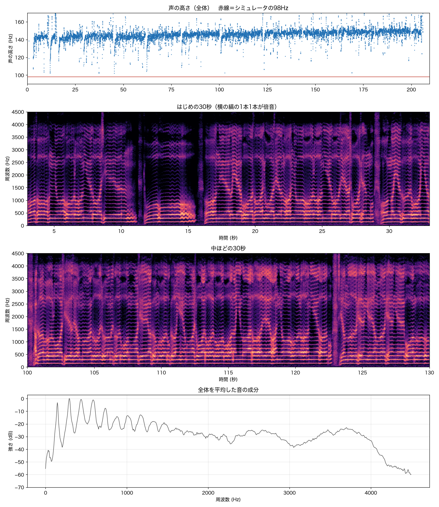
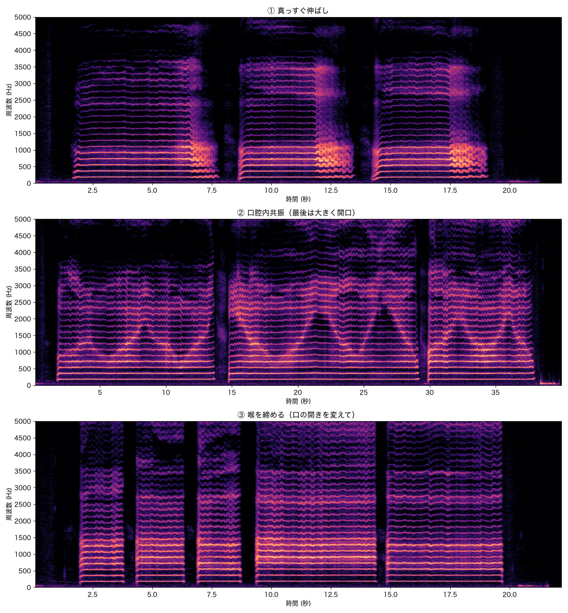
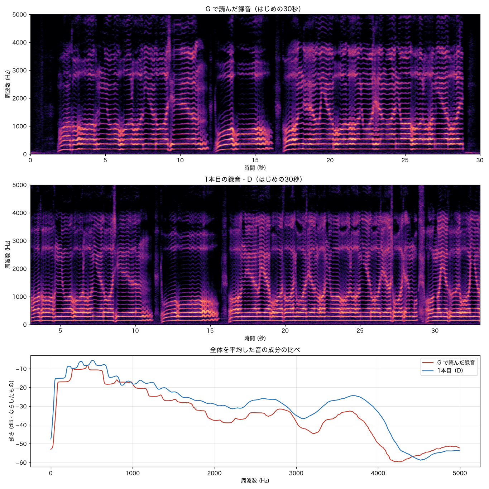

# 倍音の監修メモ：読経の経験者への聞き取り（2026-11-16）

読経の経験者（薬樹ギン）に、倍音が乗るときの舌・喉・息の使い方を一つずつ聞き取った記録です。あわせて、いまのシミュレータの作りと比べて、ずれている点と直し方の案をまとめます。

- **聞き取りの方法：** その場で実際に唱えてもらい、体の感覚を言葉にしてもらいました。そのあと、般若心経を通しで読んだ録音1本と、「あー」を伸ばした録音3本をもらい、周波数を分析しました（「録音の実測」と「母音を伸ばした録音の実測」の節）。
- **確かさの区別：** 「本人の言葉」は聞いたままです。「工学の言葉での読み」は、音響の理論に当てはめた**仮説**で、測って確かめてはいません。
- **聞き取りの相手：** 臨済宗の読経を長く続けていて、宗派の梵唄（読経・声明）の講習を修了しています。
- **宗派の違い：** このリポジトリの経文の読みとテンポの出典は曹洞宗の資料です。聞き取りの相手は臨済宗なので、読み方や節回しが出典と違う可能性があります。どこが違うかは、まだ聞いていません。
- **範囲：** 一人の経験者の感覚です。宗派の正式な発声や、読経一般を代表するものではありません。
- **コードの参照：** `index.html` の行番号は 2026-11-16 時点（コミット `d04ed3b`）のものです。

## 結論

いまのシミュレータでは、舌・喉・肺の動きと倍音の音が別々に作られています。動きが倍音を生んでいるわけではないので、「動きが倍音を出す仕組みとして正しいか」は、いまの作りでは確かめられません。

聞き取りでわかった違いは次の4つです。

| | 経験者の話 | いまのシミュレータ |
|---|---|---|
| 強さ | 伸ばすときに少し乗る程度 | F2 を 4.2 倍に強め、どの母音でもずっと鳴る |
| 出どころ | 腹からの声に口の中の響きが乗った結果 | あとから足す効果 |
| 高さの決まり方 | 舌の根で選ぶ。母音や口の開きとは別 | 母音ごとに決まる |
| 使う場所 | 舌の根、鼻への抜き、腹の支え | F2 の数値だけ。舌は母音の構え、肺は絵だけ |

録音1本の実測では、さらに次のことがわかりました（「録音の実測」の節）。

- 声の高さは人と場面で変わる。この読み手は、ふだんが約180Hz、低く読んだ1本目が約146Hz。いまの 98Hz はそのどちらよりも低い。
- 声は1秒に約5.5回、±50セントで規則正しく揺れている。
- ふだんの読経では、2700Hz と 3500〜3800Hz に、母音で動かない弱い帯がある。
- 意識して乗せるときは、舌の根で F2 にあたる共鳴を 1000〜2300Hz のあいだで動かし、倍音を1本ずつ拾っている。上の共鳴が下りてきて出会う。F2 を倍音に合わせるという、いまの考え方は合っている。違うのは、母音と切り離して動かす点、上の共鳴も動く点、ふだんの読経にはかけない点。

## 聞き取りの記録

### 1. 倍音は狙って出すものか

**本人の言葉**

> 伸ばすときに若干のる程度でがっつり載せてはいないかも

> 載せるときは少し鼻に抜くような感じで舌の根を動かすと耳のあたりに倍音が乗る感じ

**工学の言葉での読み**

- 鼻に抜く：軟口蓋を少し下げて、鼻の空洞をつなぐ。
- 舌の根を動かす：喉の奥（咽頭）と口の奥の空洞の形を変える。
- どちらも共鳴の位置を動かすので、倍音が乗る説明として筋は通ります。
- 「耳のあたりに乗る」がどの高さの倍音にあたるかは、わかっていません。

**シミュレータとのずれ**

- 倍音が強すぎます。F2 の帯域幅 25Hz、音量比 F1/F2/F3 = 0.8/4.2/0.35 で、常に笛のように鳴らしています（`index.html:964`）。
- 鼻への抜きは「ん」と鼻音の子音にしか使っていません。母音を伸ばしながら少し鼻に抜く、という状態がありません。
- 管モデルには鼻への分かれ道がまだありません（README に未実装と記載）。

### 2. 舌の根をどちらへ動かすか

**本人の言葉**

前へ出す（喉の奥が広がる）と、上へ持ち上げる（軟口蓋へ近づく）の両方。

**工学の言葉での読み**

- 前へ出す：咽頭が広がる。
- 上へ持ち上げる：舌の奥と軟口蓋のあいだに狭い所ができる。
- 舌の奥と軟口蓋のあいだを狭めると F2 と F3 が近づくことは、音声学で知られています（velar pinch）。README が引く Sundberg ら (2021) の「F2 と F3 を同じ倍音の近くへ寄せる二重フォルマント」と同じ向きです。
- 経験者の構えが二重フォルマントにあたるかどうかは**仮説**です。確かめるには録音の周波数分析が要ります。

**シミュレータとのずれ**

- F2 だけを数値で倍音に合わせ、F3 は母音のままです。
- 舌の構えは日本語5母音のままで、舌の根を前・上へ動かす構えがありません（`index.html:1036-1040`）。

### 3. 倍音の高さは何で変わるか

**本人の言葉**

> 舌の根で口腔の広さを調整すると倍音の周波数が変わる感じ
> 狭くすると高くなり広くすると低くなる
> 口を開く大きさは倍音の高さとは連動しない
> (大きく開けても舌根の調整で倍音は出る)

**工学の言葉での読み**

- 空洞は小さいほど高く共鳴します。舌の根で空洞の大きさを変え、共鳴を倍音から倍音へ移していると読めます。
- 口の開き（顎）が主に動かすのは F1、舌が主に動かすのは F2 です。倍音を担う共鳴を舌だけで操り、顎から切り離している、という話は理論と合います。

**シミュレータとのずれ**

- 倍音の高さが母音で決まります。母音が変わるたびに、その母音の F2 にいちばん近い倍音へ移ります。
- 経験者は、同じ母音・同じ口の開きのまま、舌の根だけで倍音の高さを選べます。倍音の高さは母音とは別のつまみです。

### 4. 喉と息

**本人の言葉**

> 意図しないで載るものだからあえて載せない読み方をするときは（喉を少し締める読み方）に近いかな
> あえて腹から出さない感じ

読み慣れないうちの読み方は、これに近いそうです。

> あくまでイメージだけど、声を大きく出すことにとらわれすぎると喉からの発声になって腹式の響きがなくなるから倍音どころではない、と言う印象
> 慣れてくると腹式の音に口腔内の響きが載って結果的に倍音になるのかな、と言う印象

**工学の言葉での読み**

倍音は、足すものではなく、腹で支えた声の結果として出るものです。喉で押すと消えます。なぜ消えるかは、次の3つが考えられます。どれが効いているかは決められていません。

- **声の高さの安定：** 倍音は、基音の整数倍が共鳴の山に重なり続けると聞こえます。腹で息の圧を一定に保てば高さが揺れず、倍音が山の上に留まる、と考えました。**この読みは実測と合いませんでした。** 録音では、声は規則正しく揺れています（「録音の実測」の節）。
- **声帯の鳴り方：** 喉を締めると声帯の閉じ方が変わり、声のもとに含まれる倍音の配分が変わります。
- **喉の空洞の形：** 喉を締めると喉の奥が狭まり、共鳴の位置がずれます。

**シミュレータとのずれ**

- 倍音を「倍音ボイス」という効果として足しています。発声の良し悪しとつながっていません。
- 肺・横隔膜は絵だけで、音の計算に使っていません（README に記載）。経験者の話では、腹の支えが倍音の条件です。

## 録音の実測

般若心経の経首と本文を通しで読んだ録音1本（約3分30秒、一人、無伴奏）を分析しました。

- **録音：** コンデンサーマイク（MARANTZ MPM-1000）とオーディオインターフェース（TASCAM）で録り、192kbps の AAC で書き出したものです。録音そのものはリポジトリに入れていません。
- **分析：** `tools/chant_analysis.py`（numpy だけで動きます）。声の高さは自己相関で、倍音の強さは 4096 点の周波数分析で測りました。
- **確かさ：** 録音は1本、読んだのは一人、部屋は一つです。数値はこの1回の値で、読経一般の値ではありません。

### 測った値

| | 録音 | いまのシミュレータ |
|---|---|---|
| 声の高さ | 中央値 約146Hz（D3 のあたり）。9割が 136〜153Hz | 98Hz（G2） |
| 高さの移り変わり | 142Hz から 149Hz へ、終わりに向けて少しずつ上がる | ずっと同じ |
| 高さの揺れ | 1秒に約5.5回、上下に約±50セントの規則正しい波 | 声ごとの不規則な小さいゆらぎ |
| 句の頭 | 息を継いだ直後は 110〜120Hz あたりからすくい上げる | なし |
| 切れ目 | 0.35秒より長い無音は、経首のあとの1か所だけ。本文はほぼ切れない | 句ごとに息継ぎを置く |
| 速さ | 本文は約190秒。262字とすると1字 約0.73秒 | 1字 0.58秒 |

- 声の揺れは、本人は意識していません。
- 速さの「262字」は分析した側の仮定です。読んだ範囲と字数は本人に確かめていません。

### 倍音の出方

- いちばん強いのは2番目と3番目の倍音（約290Hz、440Hz）です。
- **2700Hz あたりと 3500〜3800Hz あたりに、母音が変わっても動かない帯があります。** 倍音でいうと 18〜19番目と 24〜26番目です。強さは、いちばん強い倍音より約25dB 弱いです。
- 4000Hz より上は、伸ばしている声では急に（約18dB）弱くなります。子音の瞬間には 5000〜9000Hz の成分が入っているので、録音の経路で切れているのではなく、声の性質です。
- 1600〜2200Hz は谷になっています。

**読み（仮説）**

- 訓練した声では、高いほうの共鳴がいくつか寄り集まって一つの強い山になることが知られています（歌い手のフォルマント）。この録音の二つの帯は、それに似た形です。
- 聞き取りの「耳のあたりに乗る」倍音は、この帯である可能性があります。確かめてはいません。部屋の響きの影響も除けていません。
- 声が±50セントで揺れると、2700Hz あたりの倍音は上下に約±80Hz 動きます。倍音が共鳴の山を行き来して強さが波打ち、それが響きのきらめきになっている、とも読めます。

**シミュレータとのずれ**

- いまの倍音ボイスは、F2（1000Hz 前後）を母音ごとに倍音へ合わせて強く立てます。録音では、もっと高い所に、母音で動かない弱い帯があります。倍音が立つ場所も、強さも、動き方も違います。
- 聞き取りの「舌の根で倍音の高さが変わる」がどの帯の話なのかは、この録音からはわかりません。通しの読経では舌の根を動かしていないためです。

## 母音を伸ばした録音の実測

「あー」を伸ばした録音を3本もらい、同じ方法で分析しました（`tools/vowel_sweep_analysis.py`）。マイクと経路は読経の録音と同じです。声の高さは3本とも約180Hz です。1本目の通し読み（約146Hz）より高く、本人のふだんの読経の高さにあたります。

### ① 真っすぐ伸ばす

- 倍音は横一直線で、動く筋はありません。
- 2700Hz と 3450Hz あたりに帯があります。読経の録音の帯と同じ場所です（1本目の伸ばしだけは 2370Hz と 3100Hz）。
- 声の揺れは、伸ばしている間はほとんどなく、切る前の1〜1.5秒に出ます。

### ② 口の中で共鳴を動かす（最後は口を大きく開ける）

- **舌の根で動かしている共鳴が、約1000Hz から約2300Hz のあいだを行き来します。** 倍音を6番目から13番目まで1本ずつ拾っています。図の中段の、山形と谷形の明るい筋です。
- **上の共鳴は逆向きに動きます。** 下の共鳴が上がると、上の共鳴は約3500Hz から約2500Hz へ下がり、二つが出会います（図の21秒と26秒のあたり）。
- 出会った所の倍音（2200〜2700Hz）は、いちばん強い倍音より約13〜15dB 弱い所まで上がります。①の同じ帯（約26〜28dB 弱い）より10dB 以上強いです。
- 口を大きく開けた部分（30秒以降）でも、同じ筋が出ます。

### ③ 喉を締める（口の開きを変える）

- 4000Hz より上まで倍音が強く伸びます。①と読経では、4000Hz から上で急に弱くなっていました。
- いちばん下の共鳴が約900Hz へ上がります（①は 540〜720Hz）。
- 3450Hz あたりの帯は弱くなり、2700Hz の帯は残ります。

### 聞き取りと合った点、訂正する点

**合った点**

- 「舌の根で狭くすると高く、広くすると低く」：②の動く筋のとおりです。
- 「口の開きは倍音の高さと連動しない」：口を大きく開けても同じ筋が出ました。
- 聞き取りの2で仮説とした「F2 と F3 が寄る」：②で、二つの共鳴が出会う形が出ました。Sundberg ら (2021) の二重フォルマントと同じ向きです。ただし、口の中の形は音から推し量ったもので、直接は見ていません。

**訂正する点**

- 「録音の実測」の節で、倍音が立つ場所が違うと書きました。これは、ふだんの読経についてだけ言えることです。意識して乗せるときに動いているのは F2 にあたる共鳴で、F2 を倍音に合わせるという、いまの倍音ボイスの考え方は合っています。

**いまの倍音ボイスと違う点（3つ）**

| | 録音 | いまのシミュレータ |
|---|---|---|
| F2 の動かし方 | 同じ「あ」のまま 1000〜2300Hz を動く | 母音で決まる |
| 上の共鳴（F3） | 下りてきて F2 と出会う | 動かない |
| ふだんの読経 | 動く筋は使わない。2700Hz と 3500Hz 付近の動かない帯が弱く乗るだけ | 意識して乗せる唱え方を、読経の全部にかけている |

**③からわかること（仮説）**

- 喉を締めると、声のもとに高い倍音が増え、声が硬くなります。同時に、喉の空洞が縮んで下の共鳴が上がります。聞き取りの4で挙げた3つのうち、「声帯の鳴り方」と「喉の空洞の形」の二つが、どちらも変わっています。

## 声の高さと、合わせて読むこと

### 声の高さは人と場面で変わる

**本人の言葉**

> これはその人の出しやすい声、という感じかな

本人のふだんの高さは「G」で、終わりのほうは A に寄るそうです。身近なほかの読み手は、G から C まで上がる人、D から F まで上がる人がいるそうです（本人の記憶による高さで、測った値ではありません）。

**実測**

| 録音 | 声の高さ（中央値） | 音名でいうと |
|---|---|---|
| 1本目の通し読み（部屋で静かに） | 約146Hz | D |
| 「いつもの G」で読んだ冒頭（約25秒） | 約179Hz | F と F♯ のあいだ |
| 「あー」を伸ばした3本 | 約180Hz | F と F♯ のあいだ |

- 本人の「G」は体感の高さで、実測は G（196Hz）より1半音半ほど低い所でした。
- 1本目の 146Hz は、ふだんより3半音半ほど低い読み方でした。**146Hz を「読経の高さ」として扱わないでください。** この1本の値です。
- いまのシミュレータの 98Hz は、この読み手のふだんの声より約1オクターブ低いです。
- 聞いた3人とも、読むうちに高さが上がります（2〜5半音）。1本目の実測でも、3分半で1半音弱上がっていました。

### お経は耳で読む

**本人の言葉**

> 「お経は耳で読む」と言う通り、周りに合わせて声を合わせる、または不協和音にならないように調整する、ということも意識せずやってます、音程を取れる人ばかりではないので

**読み**

- 一人ひとりに出しやすい高さがある。
- 周りの声を聞き、自分の出しやすい範囲の中で、濁らない高さへ寄せる。
- 音程を取れない人は、寄せきれずに外れたまま残る。
- 全体は読むうちに一緒に上がる。

**シミュレータとのずれ**

- **同音読誦：** 全員が同じ高さを狙い、一人ごとに決まった量だけずらしてあります。ずれは最後まで変わらず、誰も人の声を聞いていません。
- **低音合唱：** 声を基音の 0.5倍・0.75倍・1倍（約49・73.5・98Hz）に固定で割り振っています。

**低音合唱の 49Hz について**

- README は、低音合唱を「音域を下げ、個々の声域に合わせた協和音を重ねるという経験者の助言」を取り込んだものとし、「半分」を周波数の半分と解釈した、と書いています。
- 本人に確かめました。「個々の声域に合わせる」「濁らないように重ねる」は、上の「お経は耳で読む」と同じ話で、言った覚えがあるそうです。**「半分」と 49Hz は、言った覚えがないそうです。**
- 49Hz は、人の声としてはほとんど出ない低さです。経験者の助言から出た値ではなく、合成上の設定として読んでください（README もそう断っています）。

### 自分の声を返して聞くと、倍音に気づく

「いつもの G」の録音は、マイクの音をヘッドホンに返しながら読んだものです。本人は「返しが聞こえると、ずっと倍音が出ている」と言っています。

- 2800Hz あたりの帯が、1本目よりくっきり分かれています。帯がまわりから飛び出す度合いは、中央値で約12dB から約14dB に上がりました。
- 帯そのものの強さは上がっていません。いちばん強い倍音と比べると、1本目より弱いです。
- 理由は二つ考えられ、切り分けていません。返しで高い成分が耳に届き、もともと出ていた倍音に気づいた。または、聞こえた倍音に合わせて、無意識に口の中を整えた。
- 1本目とは高さも違うので、返しの効き目だけを取り出せていません。

## 直し方の案

録音の実測から、まず次のことが値として決まります。

- **合唱の高さの決め方：** 一人ごとに出しやすい高さを持たせ、導師の声に対して濁らない高さ（同じ高さ、オクターブ、五度、四度）のうち、自分の範囲でいちばん近い所へ寄せる。寄せきれない人を少し混ぜる。全員が読むうちに一緒に上がる。人の声として出る範囲に収める。

- **倍音ボイスを二つに分ける。** 「ふだんの読経」（F2 は母音のまま。高い所に動かない弱い帯）と、「意識して乗せる」（舌の根で F2 を動かす）。いまは後者を全部にかけています。
- **意識して乗せるときの F2：** 母音と切り離し、1000〜2300Hz を動かせるつまみにする。F2 を上げるほど F3 を 3500Hz から 2500Hz へ下げ、出会わせる。強さは、いちばん強い倍音より13〜15dB 弱い所まで。

- **声の高さ：** 一つの値に決めず、選べるようにする。この読み手のふだんは約180Hz、低く読んだときで約146Hz。読むうちに1〜数半音上がる。
- **規則正しい揺れ：** 1秒に5.5回、±50セント。
- **高い所の動かない帯：** 2700Hz と 3500〜3800Hz に、弱い共鳴を母音と無関係に置く。
- **句の頭のすくい上げと、短い息継ぎ。終わりに向けて少しずつ上がる高さ。**

以下は聞き取りから出した案です。優先の順に並べます。上の2つは値を変えるだけで試せます。

1. **倍音を弱める。** 既定の F2 の音量比と帯域幅をゆるめ、「伸ばすときに少し乗る」程度にします。いまの強さは「強調」のつまみとして残します。
2. **伸ばす音でだけ乗せる。** 短い字では母音の F2 のままにし、長音や句の終わりの伸ばしでだけ倍音へ寄せます。
3. **舌の根のつまみを母音と分ける。** 「舌の根の位置（前後・上下）」を母音とは別の値として持ち、それが F2 と F3 を動かす作りにします。狭めると高く、広げると低く。舌の絵も同じ値で動かせば、動きと音がつながります。
4. **伸ばす母音に軽い鼻への抜きを入れる。** 管モデルに鼻への分かれ道を足すのが本筋です。共鳴3本方式では、既存の鼻音の共鳴を弱く混ぜて近似できます。
5. **息の支えを音につなぐ。** 「腹の支え」のつまみを作り、声の高さのゆらぎと声のもとの倍音の配分に効かせます。支えが弱いと倍音が消える、という作りです（何に効かせるかは、腹から出さない読み方の録音を測ってから決めます）。肺と横隔膜の絵をこの値で動かせば、絵が音の原因になります。「慣れた人」と「慣れない人」の違いも同じつまみで作れます。
6. **管モデルで確かめる。** 3 の構えを管の断面積として与え、F2 と F3 が寄るか、狙った倍音が立つかを計算で確かめます。ここまで来て初めて、「この形ならこの倍音が出る」と言えます。

## まだ確かめていないこと

- 低く読むとき（約146Hz）でも、舌の根で同じように共鳴を動かせるか。母音を伸ばした録音は約180Hz でした。
- 「あ」以外の母音で、舌の根がどこまで動かせるか。
- 「耳のあたりに乗る」倍音が、実測の二つの帯と同じものか。
- 喉を締めた声で、本文を読んだときの違い。伸ばした「あー」では測りましたが、読経では測っていません。
- 同じ高さで、返しのある・なしを録り比べること。倍音の出し方が変わるのか、聞こえ方が変わるだけなのか。
- 何人かで一緒に読んだときの、互いの高さの関係。聞き取りだけで、測っていません。
- 部屋の響きの影響。別の部屋か、口元に近い録音との比較。
- 録音が1本だけであること。日や体調で値がどれだけ変わるか。
- 腹から出さないと声の何がいちばん変わるか（高さの揺れ・声の硬さ・音量・息の続き）。聞き取りの途中です。
- 子音や息継ぎの扱いが、経験者の読み方と合っているか。まだ聞いていません。
- 曹洞宗の資料に合わせた読み・テンポ（1字0.58秒）と、臨済宗の読み方との違い。
