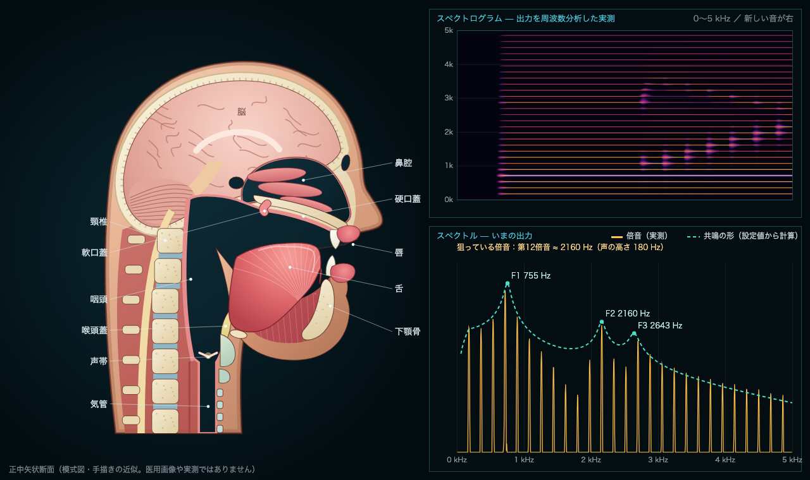

# 監修メモの続き：足したつまみ・曲・解剖ビューと、測って確かめた値（2026-11-16）

[監修メモ](kanshu-overtone-gin.md) と [指示書](kanshu-overtone-shijisho.md) のあとに足したものの記録です。指示書が「やらないこと」に置いていた項目のうち、**書き出した音を測って合わせる往復で値が決まるもの**だけを足しました。

- **既定の音は変えていません。** 足したつまみは初期値のままなら従来と同じ音です（下の「既定の音」の照合）。
- **音が正しいかは人が聞いて決めます。** ここに書くのは、書き出した WAV を測った数値だけです。**聴感は未確認です。**
- 録音の値は監修メモのもの（読み手1人・1部屋・各1回）で、読経一般の値ではありません。

## 足したもの

| | 何をするか | 根拠 | この版で決めたこと |
|---|---|---|---|
| つまみ「高い所の動かない帯」 | 2700Hz と 3650Hz に、母音で動かない弱い共鳴を足す。0 で従来どおり、1 で実測の強さ | 監修メモ：2700Hz と 3500〜3800Hz に母音で動かない帯。いちばん強い倍音より約25dB 弱い | 帯の幅（300Hz・400Hz）、3500〜3800 の中心を 3650 としたこと |
| 曲「あー（舌の根で倍音を渡る）」 | 約180Hz の「あー」のまま、F2 を 1000→2300Hz、F3 を 3500→2500Hz へ動かし、倍音を6番目から13番目まで1本ずつ渡って戻る | 監修メモの録音②：動く範囲、拾う倍音、F3 が下りて出会うこと、出会う所の強さ（−13〜−15dB） | 1本あたり0.5秒・2往復・前後の真っすぐな区間。途中の強さ（直線でつないだ）。帯域幅 |
| 舌の絵 | 「舌の根」のつまみとスイープで、舌の奥が前・上へ動く。顎と唇は動かさない | 聞き取り：前へ出す＋上へ持ち上げる。口の開きは連動しない | 動かす量（見て分かる大きさに置いた値。実測ではない） |
| 合唱の揺れ | 声ごとに揺れの速さを最大±7%ずらす | 指示書の「限界」：合唱では全員に同じ揺れがかかる | ずらす量。何人かで読んだときの揺れは測られていない |
| 解説文の F0 | 「声の高さ」「F2 を倍音に合わせる」に合わせて書き換わる | 指示書の「限界」 | — |
| 「解剖」タブ | 色を付けた断面図、スペクトログラム、スペクトルと共鳴の形 | — | 下の「解剖ビュー」 |

## 測った値

アプリの「WAV 書き出し」で作った音（1人・共鳴3本方式・残響なし・44.1kHz）を、監修メモと同じ考え方（自己相関で声の高さ、4096点の周波数分析で倍音ごとの山）で測りました。

### 「実測の値」ボタン（般若心経 全文）

| | 録音（監修メモ） | 合成を測った値 |
|---|---|---|
| 声の高さ（中央値） | 約179〜180Hz | 178.9Hz |
| 終わりに向けて上がる量 | 1本目の録音で 142→149Hz（約83セント） | 175.4→182.9Hz（冒頭と末尾それぞれ15%の中央値の比で 73セント。設定は 83セント） |
| 揺れの速さ | 1秒に約5.5回 | 5.47回 |
| 揺れの幅 | 約±50セント | ±35〜49セント（2秒続けて声が出ている区間だけで測った値。区間が少なく、ばらつく） |

### 「高い所の動かない帯」＝1（「実測の値」に重ねた場合）

| | 録音 | 帯 0 | 帯 1 |
|---|---|---|---|
| 2700Hz あたり（いちばん強い倍音との差） | 約 −25dB | −32.5dB | −23.1dB |
| 3500〜3800Hz あたり | 約 −25dB | −37.5dB | −24.0dB |
| あいだの谷（3000〜3300Hz） | — | −32.2dB | −30.1dB |
| 1600〜2200Hz の谷 | 谷になっている | −27.5dB | −29.5dB（最も低い所は −36dB） |

録音より 1〜2dB 強めです。つまみを 0.8〜0.9 にすると −25dB 付近になります（測ったのは 0 と 1 だけです）。

### 曲「あー（舌の根で倍音を渡る）」

| 舌の根 | 狙った倍音 | いちばん強い倍音との差 |
|---|---|---|
| 0（広い） | 第6倍音 1080Hz | −11.8dB |
| 1/7 | 第7 1260Hz | −12.5dB |
| 2/7 | 第8 1440Hz | −13.4dB |
| 3/7 | 第9 1620Hz | −14.6dB |
| 4/7 | 第10 1800Hz | −13.8dB |
| 5/7 | 第11 1980Hz | −13.8dB |
| 6/7 | 第12 2160Hz | −14.5dB |
| 1（狭い） | 第13 2340Hz（隣の 2520Hz は −15.9dB） | −13.7dB |

録音②は、出会った所（2200〜2700Hz）で −13〜−15dB でした。出会う所は合っています。**途中の強さは録音から値を取っていない**ので、合っているかは分かりません。

### 既定の音

変更前（コミット `87ce65d`）と変更後で、既定のまま般若心経全文を書き出して1標本ずつ比べました。差は最大で16ビットの1目盛り、約727万標本のうち約1000標本です。変更前どうしを2回書き出しても同じ大きさの差が出るので、書き出し自体のゆらぎの範囲です（比較のため、雑音の乱数は固定しました）。

## 解剖ビュー（「解剖」タブ）

- **左の断面図：** 線画・3D と同じ構え（舌・顎・唇・軟口蓋）で動きます。骨・脳・軟骨・筋・気道の形と色、位置は**手描きの模式図**で、解剖図譜や医用画像と照合していません。音の計算には使っていません。
- **右上のスペクトログラム、右下の金色の線：** 出力を実際に周波数分析した値です（8192点。合唱では全員ぶんの合計、残響も含みます）。
- **右下の緑の点線：** 合成器の設定値（共鳴の位置・帯域幅・音量比・声源の傾きと高域上限・高い帯）から計算した共鳴の形です。実測の線に高さを合わせて重ねているので、縦の位置は目安です。管モデルを使っているときは、管の計算結果ではなく目標の共鳴を描きます。

## まだ確かめていないこと

- **聴感。** 帯・スイープ・合唱の揺れのどれも、人が聞いていません。
- 管モデルでは「高い所の動かない帯」は鳴りません（共鳴3本方式の経路に足したため）。
- 合唱＋揺れ、鳴らし物との組み合わせでの聞こえ方。
- 「解剖」タブの動きの重さ（実機）。Chrome 以外のブラウザ。確認は Chrome（headless）での再生と撮影だけです。
- 監修メモの「まだ確かめていないこと」は、そのまま残っています。
